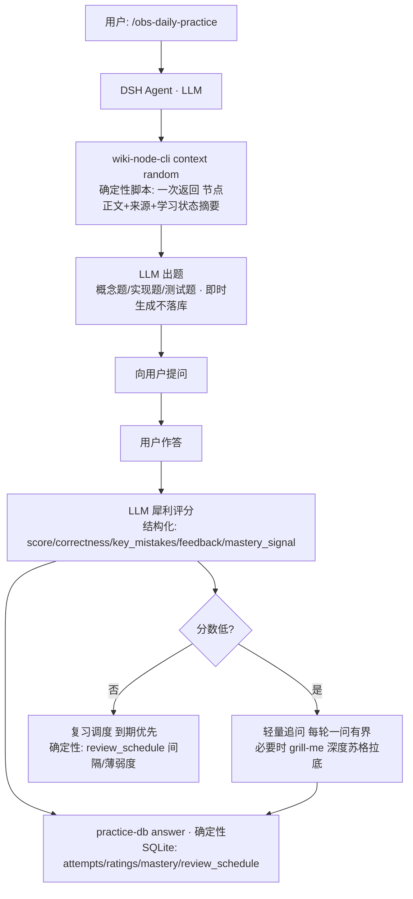

# 检索与每日一练

## 知识检索 `/obs-knowledge-search`

不是每次遇到问题都去海量资料里重新翻一遍，而是**从自己积累的知识中**找到相关内容和依据，结合 DSH 模型合成答案，并提供可信引用。

- **Wiki 优先检索**：先查 KarpathyWiki 编译层（`wiki/concepts` / `entities` / `sources`），命中概念/实体节点后回原始笔记取证
- **意图分类**：识别问题类型，选择检索策略
- **工程细节**：停用词剥离、分词回退、元数据文件过滤（检索代码位于 `src/search/`）
- **答案有出处**：每条结论附来源路径（如 `wiki/concepts/json-schema.md`），可点开验证

> 诚实说明：检索质量仍在持续测试和完善中。

## 每日一练 `/obs-daily-practice`

看懂一遍，和自己能不能讲清楚，是两回事。每日一练从 wiki 节点即时抽题、评估作答、纠正错误，用 SQLite 持久化跟踪掌握度与复习调度。

### 流程图

### 职责边界

| 环节 | 归属 | 说明 |
|---|---|---|
| 抽节点/聚合上下文 | **确定性脚本** | wiki-node-cli context 一次返回全量（S3 治理后无边界探索） |
| 出题 / 评分 / 追问 | **LLM（Agent）** | 即时出题、犀利评分、苏格拉底追问 |
| 记录 / 复习调度 | **确定性代码 + SQLite** | attempts/ratings/mastery/review_schedule；答对间隔 ×2（1–30 天封顶）、答错重置 1 天、到期优先 |

### 学习状态（全部 SQLite，绝不写入 Vault 笔记）

| 表 | 内容 |
|---|---|
| `questions` | 出题记录（即时生成仅留痕，**非静态题库**） |
| `attempts` | 作答（只追加，关联题目版本） |
| `ratings` | 评分 / 反馈 / 错误分析 |
| `mastery_history` | 概念掌握度证据（区分首次回答/模型评价/纠错/变式验证） |
| `review_schedule` | 复习调度（next_review / interval / streak） |

查看/导出：`practice-db status` / `practice-db export`。

### 实际效果

## 追问教学 `/obs-grill-me`

- **触发**：用户主动要求「grill me」；或 `/obs-daily-practice` 首次评分低于 6/10（调用 `practice_grill_gate` 确认，`required=true` 时**强制进入**，不是可选项）
- **方式**：每轮只问一个关键问题（`ask_user_question`，2-4 个具体选项），依次压测目标/证据/因果/边界/反例/应用，最多 8 轮；学会后用变式题复验
- **人格**：插件配置页的 `grillPersona`（可保存，volatile 即时生效；默认内置严厉严谨教师）。技能加载时把 `{{persona}}` 渲染为当前人格，`practice_grill_gate` 返回同一人格，两处不会漂移
- **边界**：追问过程只写 SQLite 学习状态，不写入 Obsidian 正式知识笔记
