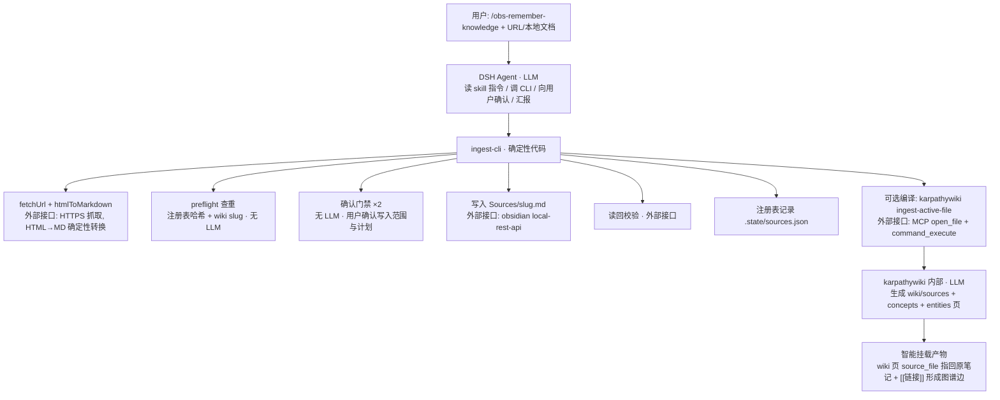

# 知识摄入流程

对应命令：`/obs-remember-knowledge`

把 URL（仅 https）或本地 `.md` 安全纳入知识体系。设计原则：**确定性代码管流程，LLM 管组织与汇报，Obsidian 侧插件管编译挂载**——所有对正式 Vault 的写入都经过确认门禁，只 create、绝不静默覆盖人工笔记。

## 流程图



## 职责边界

| 环节 | 归属 | 说明 |
|---|---|---|
| 流程组织/确认/汇报 | **LLM（Agent）** | 读 skill、调用 CLI、向用户确认、汇报结果 |
| 抓取/清洗/转换 | **确定性代码** | fetchUrl + htmlToMarkdown（S3 治理后模型不再手写转换器） |
| 查重/门禁/写入/校验/注册 | **确定性代码** | preflight/pipeline，create-only、读回校验、注册表 |
| 编译挂载 | **外部接口 + Obsidian 侧 LLM** | karpathywiki 调 LLM 生成概念/实体/来源页 |

## 原文去向（逐步）

```
URL（仅 https）或本地 .md
  → 规范化（sha256 content_hash、source_id）
  → 预检（`.state/sources.json` 注册表按 content_hash 精确查重 + wiki/sources 同 slug 匹配查重）
  → 用户确认 ×2（范围、写入计划）
  → create-only 写入 → Sources/<slug>.md   ← 原文正文存于此
  → 读回校验
  → karpathywiki 编译 → wiki/ 派生页（source_file 可追溯）
  → 注册表记录（hash → vault 路径）
```

## 智能挂载到 Obsidian

1. 摄入**只写 `Sources/<slug>.md`**（原样正文 + frontmatter：`source_uri` / `source_id` / `content_hash` / `fetched_at`），不污染其他目录
2. 可选编译：karpathywiki 以该文件为活动文件，生成 `wiki/sources/<slug>_<hash>.md`，并抽取正文生成 `wiki/concepts/`（概念）、`wiki/entities/`（实体）页
3. 页面内 `source_file: [[Sources/...]]` 与正文 `[[概念/实体]]` 链接 → 形成**知识图谱边**，检索/图谱/右侧栏面板都消费这些挂载产物
4. 编译限流（request burst）时：来源已安全入库，`compile-cli pending` 列出待编译，冷却后补编译

## 实际效果

预检与写入结果（无重复 → create-only 写入 → 哈希校验通过）：


> 编译耗时约 6 分钟/源（LLM），CLI 阻塞等待，超时/轮询/settle 可配置，见 [[配置参考]]。
