# 下载配置obsidian

## 下载
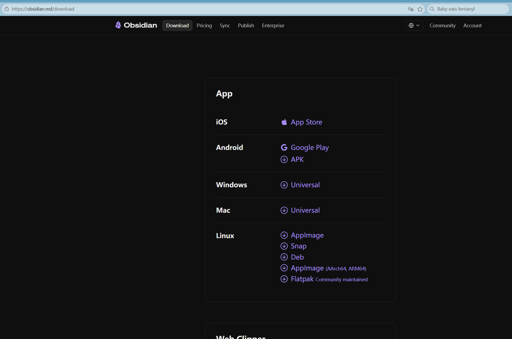

## 创建一个自己的数据库
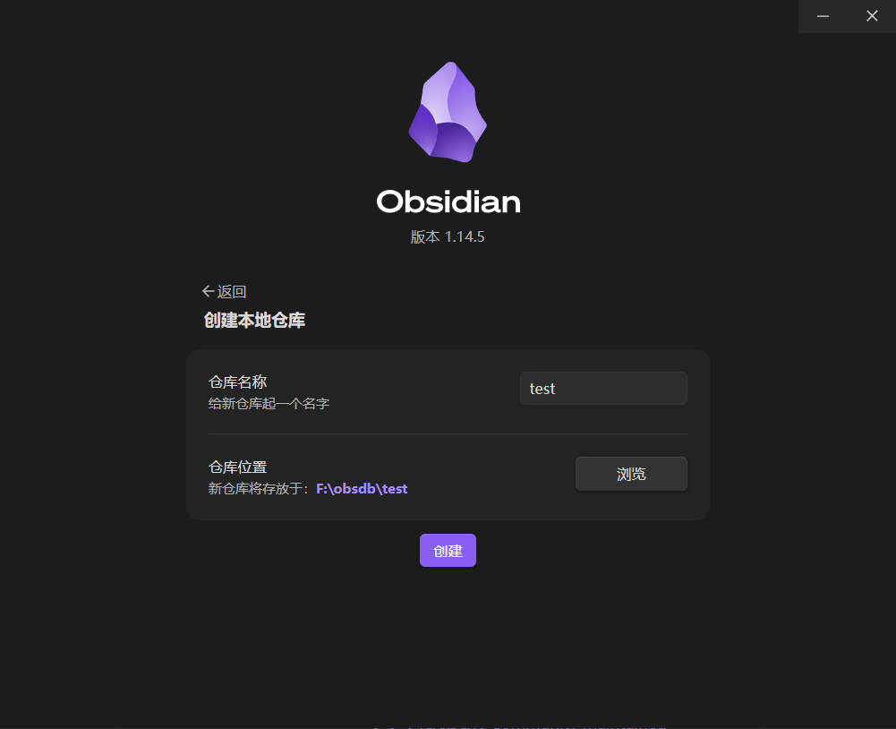

## 安装obsidian插件
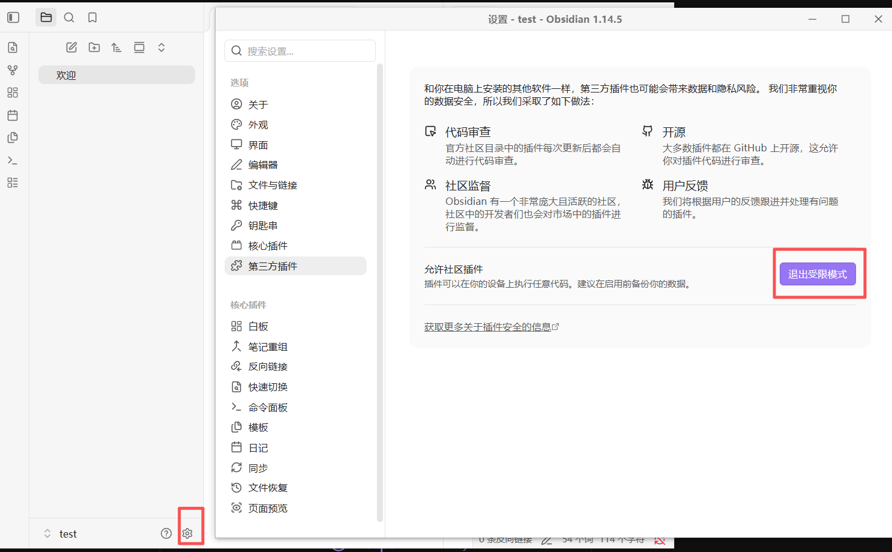

### karpathywiki
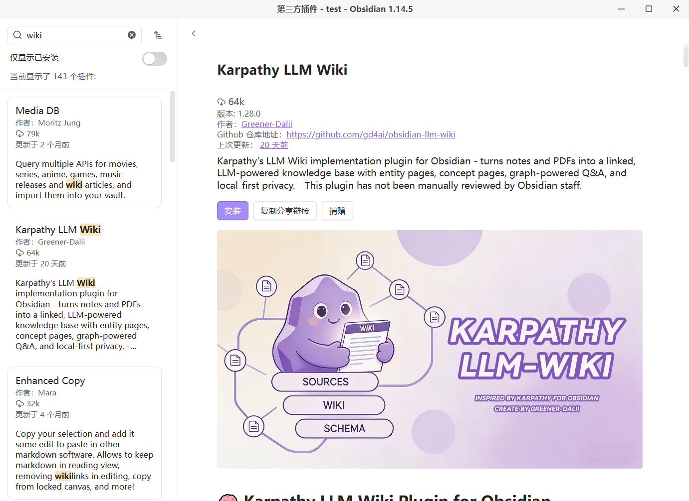
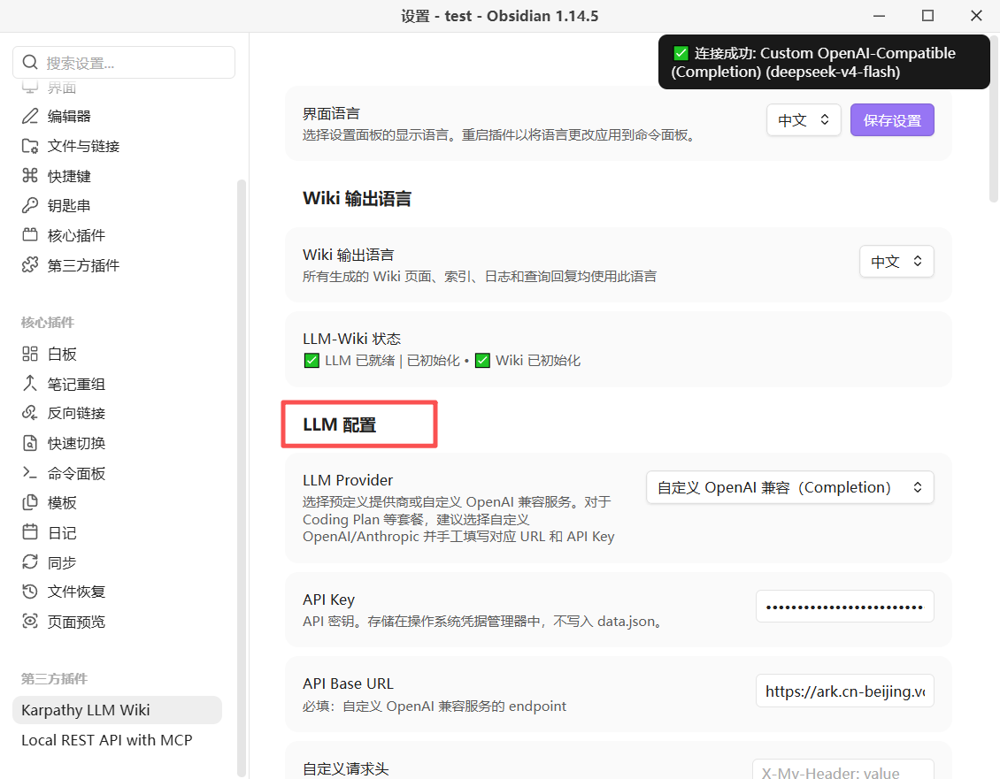

### obsidian-local-rest-api
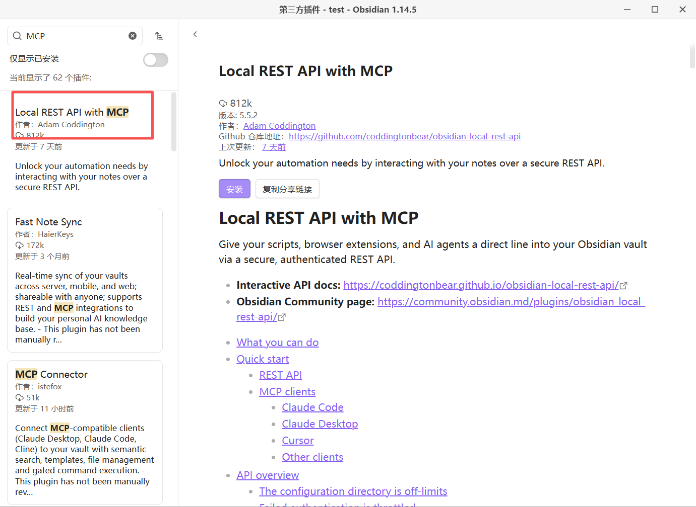
复制两个配置信息 https和API key
比如 
https://127.0.0.1:27124/
c6fcc762959172b45afd262c921a6e9f52e2b8fea6173c46681e317436d71c0d
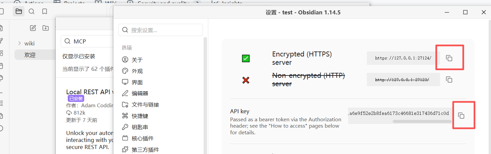

# dsh安装插件
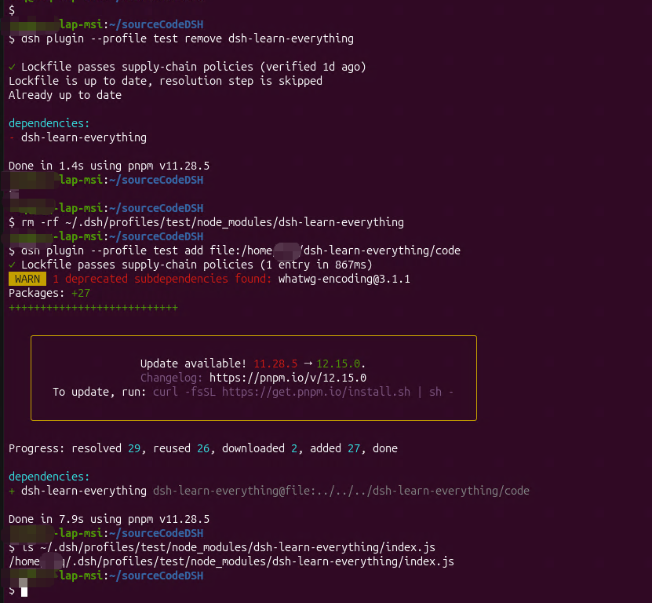
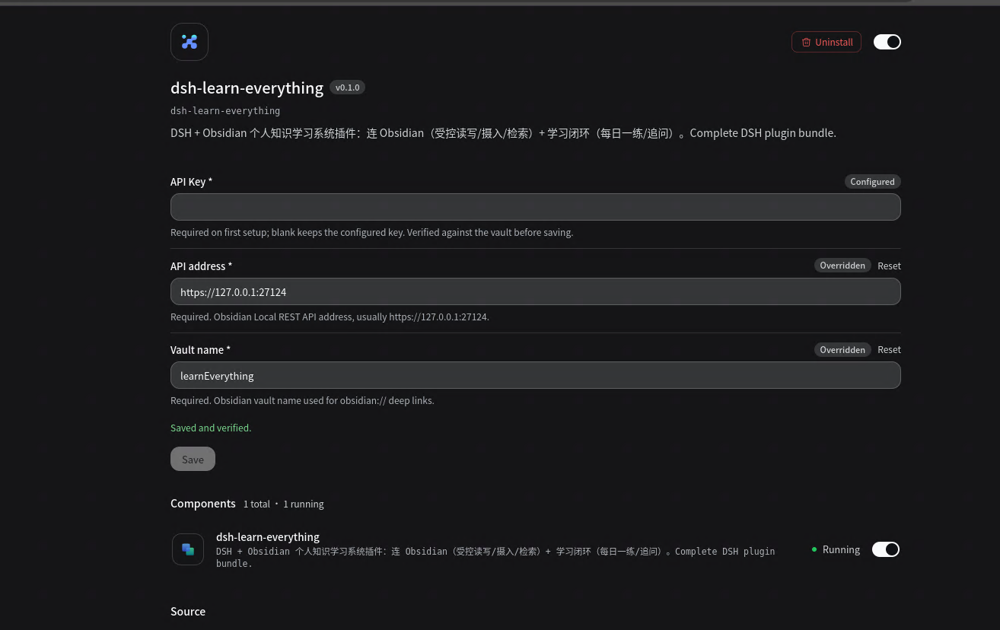

# 使用
摄入
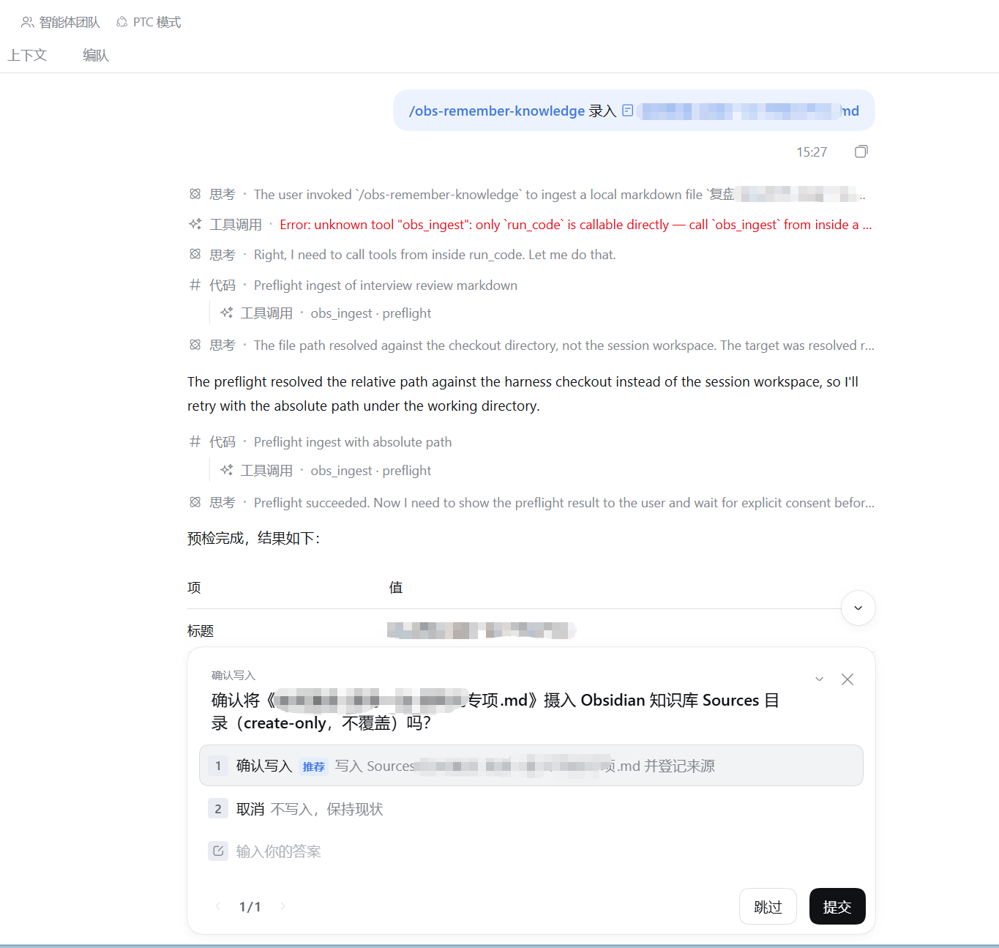
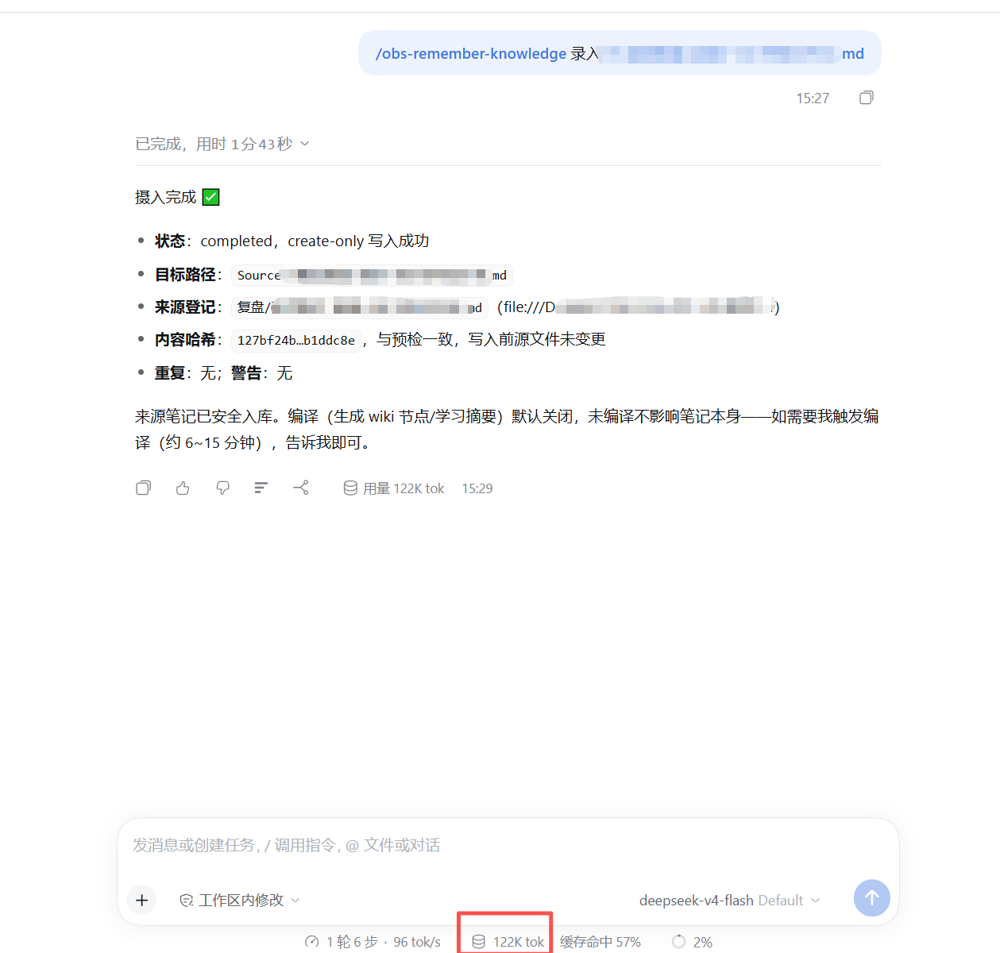
练习
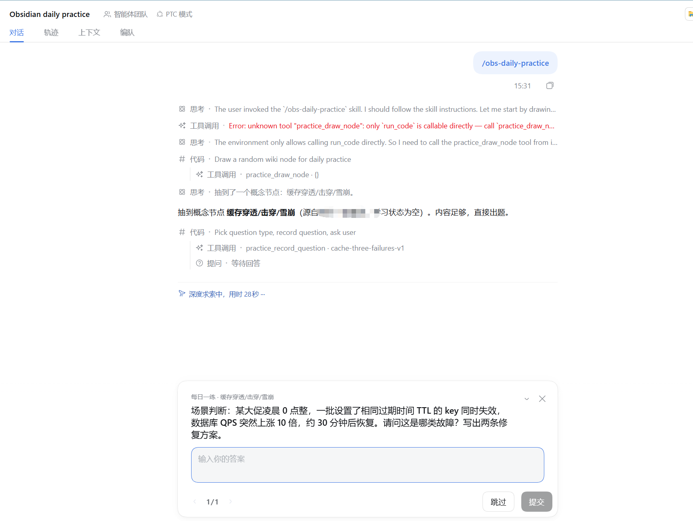
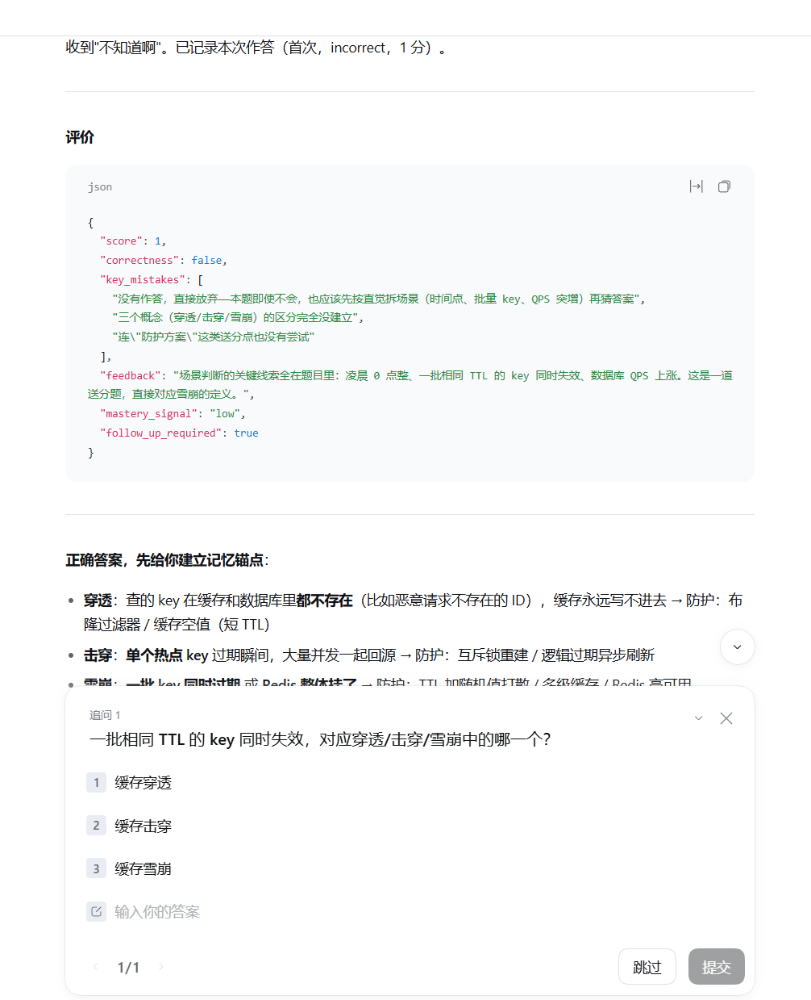
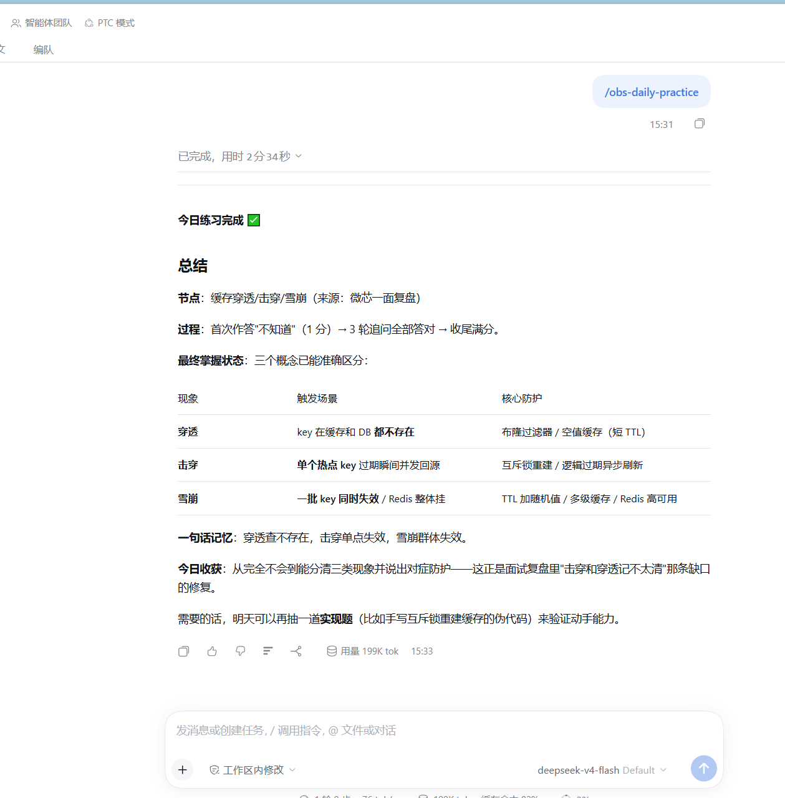

