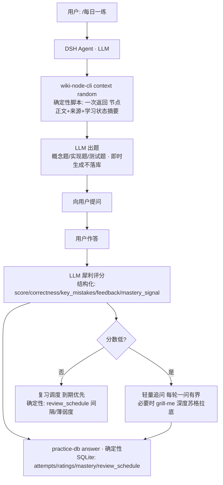

# 核心流程说明：知识摄入 & 每日一练

> 说明每条链路中：确定性代码 / LLM / 外部接口 的职责边界，以及 Obsidian 侧（三方）哪里用到 LLM、知识如何智能挂载。

---

## 一、知识摄入（/记住知识）

### 流程图

```mermaid
flowchart TD
  U[用户: /记住知识 + URL/本地文档] --> A[DSH Agent · LLM<br>读 skill 指令 / 调 CLI / 向用户确认 / 汇报]
  A --> C[ingest-cli · 确定性代码]
  C --> F[fetchUrl + htmlToMarkdown<br>外部接口: HTTPS 抓取, HTML→MD 确定性转换]
  C --> P[preflight 查重<br>注册表哈希 + wiki slug · 无 LLM]
  C --> G[确认门禁 ×2<br>无 LLM · 用户确认写入范围与计划]
  C --> W[写入 Sources/slug.md<br>外部接口: obsidian local-rest-api]
  C --> V[读回校验 · 外部接口]
  C --> REG[注册表记录 code/.state/sources.json]
  C --> K[可选编译: karpathywiki ingest-active-file<br>外部接口: MCP open_file + command_execute]
  K --> KW[karpathywiki 内部 · LLM<br>生成 wiki/sources + concepts + entities 页]
  KW --> MOUNT[智能挂载产物<br>wiki 页 source_file 指回原笔记 + [[链接]] 形成图谱边]
```

### 职责边界

| 环节 | 归属 | 说明 |
|---|---|---|
| 流程组织/确认/汇报 | **LLM（Agent）** | 读 skill、调用 CLI、向用户确认、汇报结果 |
| 抓取/清洗/转换 | **确定性代码** | fetchUrl + htmlToMarkdown（S3 治理后模型不再手写转换器） |
| 查重/门禁/写入/校验/注册 | **确定性代码** | preflight/pipeline，create-only、读回校验、注册表 |
| 编译挂载 | **外部接口 + Obsidian 侧 LLM** | karpathywiki 调 LLM 生成概念/实体/来源页 |

### 外部接口清单

- **HTTPS**：抓取 URL（fetchUrl）
- **obsidian local-rest-api**：vault 读写（写入 Sources/、读回校验）、MCP（open_file / command_execute）
- **karpathywiki（Obsidian 插件）**：ingest-active-file 编译 —— **其内部调用 LLM** 生成 wiki 概念/实体/来源页

### 智能挂载到 Obsidian

1. 摄入**只写 Sources/<slug>.md**（原样正文 + frontmatter：source_uri/source_id/content_hash/fetched_at），不污染其他目录
2. 可选编译：karpathywiki 以该文件为活动文件，生成 wiki/sources/<slug>_<hash>.md，并抽取正文生成 wiki/concepts/（概念）、wiki/entities/（实体）页
3. 页面内 source_file: [[Sources/...]] 与正文 [[概念/实体]] 链接 → 形成**知识图谱边**，检索/图谱/右侧栏面板都消费这些挂载产物
4. 编译限流（request burst）时：来源已安全入库，compile-cli pending 列出待编译，冷却后补编译

---

## 二、每日一练（/每日一练）

### 流程图



### 职责边界

| 环节 | 归属 | 说明 |
|---|---|---|
| 抽节点/聚合上下文 | **确定性脚本** | wiki-node-cli context 一次返回全量（S3 治理后无边界探索） |
| 出题 / 评分 / 追问 | **LLM（Agent）** | 即时出题、犀利评分、苏格拉底追问 |
| 记录 / 复习调度 | **确定性代码 + SQLite** | attempts/ratings/mastery/review_schedule；间隔幂次递增、答错重置、到期优先 |

### 学习状态（全部 SQLite，决策 B）

- questions：出题记录（即时生成仅留痕，**非静态题库**）
- attempts：作答（只追加，关联题目版本）
- ratings：评分/反馈/错误分析
- mastery_history：概念掌握度证据（区分 首次回答/模型评价/纠错/变式验证）
- review_schedule：复习调度（next_review/interval/streak）
- 不写 Obsidian 笔记；查看/导出：practice-db status/export
